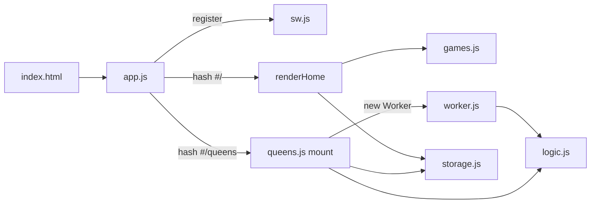

# Architecture

## Startup flow

1. `index.html` renders the static top bar (back link + title) and an empty `<main id="app">`, then loads `js/app.js` as a module.
2. `app.js` registers `sw.js` and calls `route()`.
3. `route()` reads `location.hash`:
   - `#/` or unknown → `renderHome()` builds a card per entry in `games` (from `js/games.js`).
   - `#/<id>` for a registered, non-`comingSoon` game → dynamic `import()` of the game module, then `mod.mount(app)`.
4. On every `hashchange` the previous game's unmount function is called before the next route renders.
   A `routeToken` counter discards stale async imports if the user navigates quickly.



## Game contract

Every game module exports:

```js
export function mount(root) {   // root = <main id="app">, already emptied
  // render into root, attach listeners, start timers
  return () => { /* unmount: stop timers, save, remove document/window listeners, terminate workers */ };
}
```

Rules:

- The shell owns the top bar (title + back button). The game owns everything inside `root`.
- Listeners on `root` or its children are discarded automatically when the next route replaces the content; listeners on `document`/`window` **must** be removed in unmount.
- Save the in-progress game under the storage key `<id>:game` and include a boolean `solved`. The home screen shows a "Continue" badge when `store.get('<id>:game')` exists and `solved` is false.
- Registry entry fields (`js/games.js`): `id`, `name`, `tagline`, `icon` (inline SVG markup, 40×40 viewBox), `load: () => import(...)`, optional `comingSoon: true` (renders a disabled card and blocks the route).

## Storage (`js/storage.js`)

`store.get(key, fallback)`, `store.set(key, value)`, `store.remove(key)`. Values are JSON. Keys are prefixed with `logic-games:` in `localStorage`. Errors (quota, private mode) are swallowed so games still work without persistence.

Current keys:

| Key | Owner | Content |
| --- | --- | --- |
| `queens:game` | Queens | Current puzzle + progress (see [queens.md](queens.md#saved-game-shape)). |
| `queens:settings` | Queens | Help toggles + last chosen size/difficulty. |
| `queens:stats` | Queens | `{ [size]: { solved, bestMs } }`. |
| `queens:next` | Queens | Pre-generated next puzzle: `{ key: "<size>:<difficulty>", puzzle }`. |

If a stored shape changes incompatibly, either migrate on load or guard with a check (Queens treats a game without `regions` as missing and generates a new one).

## Offline / PWA (`sw.js`, `manifest.webmanifest`)

- **Install:** opens cache `logic-games-<VERSION>` and `addAll(FILES)` with `cache: 'reload'` (bypasses the browser HTTP cache; GitHub Pages sends `max-age=600`, which could otherwise precache stale files), then `skipWaiting()`. If any file in `FILES` 404s, install fails and the old version stays active — keep the list accurate.
- **Activate:** deletes caches from other versions, then `clients.claim()`.
- **Fetch:** same-origin GETs only; cache-first (`ignoreSearch: true`), falling back to network; offline navigations fall back to the cached `./`.
- **Updating:** a new `VERSION` installs a new worker; `app.js` listens for `controllerchange` and reloads the page once, so the user gets a consistent new set of files.
- Files not in `FILES` are still served from the network when online but will be missing offline.
- The manifest uses relative `start_url`/`scope` (`./`) so it works under the GitHub Pages sub-path. iOS uses the `apple-touch-icon` PNG from `index.html`.

## Styling (`css/style.css`)

Single stylesheet, sections: variables/theme → shell (`.topbar`, `main`) → home (`.game-list`, `.game-card`, `.badge`) → shared buttons (`.btn`, `.primary`, `.ghost`, `.selected`) → Queens board → dialogs (`.sheet`, `.toggles`, `.switch`). Layout max width is 560px, mobile-first. Dialogs use the native `<dialog>` element with `showModal()`.
